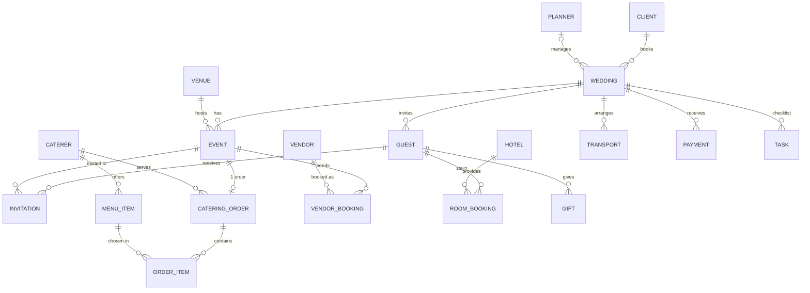

# Wedding Management System (DBMS Mini Project)

A complete wedding-planning database in **MySQL 8** with a small wedding-themed web front end (Node.js).
It manages couples, planners, venues, events (Haldi, Mehendi, Sangeet, Wedding, Reception), guest lists and RSVPs,
catering and menus, vendors (photographer, decorator, DJ...), hotel rooms for outstation guests, transport,
payments, budget, checklists and gifts.

> **Focus of the project = the database** (`sql/` folder). The web app only demonstrates it.

---

## 1. How to run

1. **Create the database** (asks for your MySQL password once)
   ```
   setup_database.bat
   ```
   (or: `mysql -u root -p < sql/00_run_all.sql` from this folder, or `source sql/00_run_all.sql` in MySQL Workbench)
2. **Create `.env`**: copy `.env.example` to `.env` and put your MySQL password in `DB_PASSWORD`.
3. **Start the app**
   ```
   start_app.bat
   ```
   then open <http://localhost:3000>.  (First run does `npm install`; Node.js is required.)

To reset all data to the original sample data, run `setup_database.bat` again.

## 2. Files

| File | Purpose |
|---|---|
| `sql/01_schema.sql` | DDL: 20 tables, all constraints, indexes |
| `sql/02_sample_data.sql` | DML: realistic sample data (5 weddings, 30 guests, ...) |
| `sql/03_views_functions_procedures_triggers.sql` | 6 views, 7 functions, 5 procedures, 9 triggers |
| `sql/04_dbms_concept_queries.sql` | **65 numbered demo queries**, one per DBMS concept (use this in the viva) |
| `sql/05_dcl_users_and_privileges.sql` | DCL: users, GRANT / REVOKE (run separately as root) |
| `server.js`, `public/` | Web app (Express + plain JavaScript) |

## 3. ER diagram



`AUDIT_LOG` is a stand-alone table written only by triggers.

**Relationship types used**
* **1 : N** - client-wedding, wedding-event, wedding-guest, venue-event, caterer-menu_item ...
* **1 : 1** - event-catering_order (`UNIQUE event_id`)
* **M : N** (resolved by junction tables) - guest-event = `INVITATION`, catering_order-menu_item = `ORDER_ITEM`, event-vendor = `VENDOR_BOOKING`

## 4. DBMS concepts and where to find them

| Concept | Where |
|---|---|
| DDL (CREATE, ALTER, DROP, TRUNCATE) | `01_schema.sql`, `04` Q1-Q2 |
| Data types incl. ENUM, DECIMAL, DATE, TIME, TIMESTAMP, BOOLEAN | `01_schema.sql` |
| PRIMARY KEY, composite key, AUTO_INCREMENT | `01_schema.sql` (`invitation`, `order_item`) |
| FOREIGN KEY, `ON DELETE CASCADE / SET NULL / RESTRICT` | `01_schema.sql`; demos `04` Q48, Q49, section 14 |
| UNIQUE, composite UNIQUE, NOT NULL, DEFAULT, CHECK | `01_schema.sql`; demos `04` Q46-Q50 |
| Indexes and EXPLAIN | `01_schema.sql` bottom; `04` Q57-Q58 |
| INSERT / UPDATE / DELETE | `02_sample_data.sql`, `04` Q3-Q5 |
| SELECT, WHERE, LIKE, IN, BETWEEN, ORDER BY, LIMIT, DISTINCT, CASE | `04` Q6-Q11 |
| Built-in functions (string, date) | `04` Q12-Q13 |
| Aggregates, GROUP BY, HAVING, ROLLUP | `04` Q14-Q18 |
| Joins: inner, left, right, self, cross, multi-table, M:N | `04` Q19-Q26 |
| Subqueries: scalar, IN, EXISTS, correlated, ALL, derived table | `04` Q27-Q33 |
| Set operations: UNION, INTERSECT, EXCEPT | `04` Q34-Q36 |
| CTE and window functions (RANK, ROW_NUMBER, LAG, running SUM) | `04` Q37-Q40 |
| Views | `03` section B, `04` Q41 |
| Stored functions | `03` section A, `04` Q42 |
| Stored procedures (IN/OUT, IF, handlers, CURSOR, LOOP) | `03` section D, `04` Q43 |
| Triggers (BEFORE/AFTER, SIGNAL, audit log) | `03` section C, `04` Q51-Q56 |
| Transactions: COMMIT, ROLLBACK, SAVEPOINT, ACID | `04` Q44-Q45, `sp_cancel_wedding`, `sp_add_payment` |
| DCL: users, GRANT, REVOKE | `05_dcl_users_and_privileges.sql` |

### Triggers
| Trigger | Rule enforced |
|---|---|
| `trg_wedding_after_insert` | creates a 6-task starter checklist for every new wedding |
| `trg_wedding_after_update` | logs wedding status changes in `audit_log` |
| `trg_event_before_insert/update` | expected guests must not exceed venue capacity |
| `trg_guest_after_insert/delete` | audit log of guest additions / removals |
| `trg_payment_before_insert` | total payments cannot exceed the wedding budget |
| `trg_order_item_before_insert` | a dish must belong to the caterer of the order |
| `trg_invitation_before_update` | stamps `responded_on`, clears table no. on decline |

### Stored procedures
| Procedure | Shows |
|---|---|
| `sp_wedding_summary(id)` | procedure returning several result sets from views |
| `sp_add_payment(...)` | OUT parameter, transaction, exception handler, trigger interaction |
| `sp_book_vendor(...)` | business check (vendor free on that date) + transaction |
| `sp_cancel_wedding(id)` | multi-table atomic update (all or nothing) |
| `sp_assign_tables(event)` | CURSOR + LOOP: seats accepted guests 8 per table |

### Functions
`fn_total_paid`, `fn_venue_cost`, `fn_catering_cost`, `fn_vendor_cost`, `fn_accommodation_cost`, `fn_transport_cost`, `fn_total_expense` (these power the budget view and the Budget Breakdown screen).

## 5. Normalization (up to 3NF)

* **1NF** - every column is atomic. Multi-valued facts are separate rows: a guest's invitations are rows in `invitation`, a menu is rows in `order_item`, not a comma-separated list.
* **2NF** - tables with composite keys (`invitation`, `order_item`) contain no attribute that depends on only part of the key (`rsvp_status` depends on *both* guest and event).
* **3NF** - no transitive dependencies: venue details live in `venue`, not in `event`; the caterer's phone lives in `caterer`, not in `catering_order`; the bride/groom names live in `client`, not repeated in `wedding`.
* Derived values (budget, plate totals, nights) are **not stored**; they are calculated by functions/views so they can never go out of sync.

## 6. Web app screens

* **Dashboard** - counts, upcoming weddings with countdown, RSVP chart, latest audit-log entries
* **Weddings** - one page per wedding with tabs: Overview (budget vs spend), Events, Guests, RSVP, Catering (menu picker), Vendors, Stay, Transport, Payments, Checklist, Gifts
* **Venues / Vendors / Caterers / Hotels / Planners** - directories with add / edit / delete
* **DBMS Lab** - live schema (tables, keys, triggers, procedures), read-only **SQL console** with sample queries, **"Try the rules"** buttons that deliberately break constraints/triggers so MySQL's own error is shown, and the audit log.

## 7. Sample viva questions this project can answer

1. *Difference between DELETE, TRUNCATE and DROP?* - Q1, section 14.
2. *What is a foreign key? What does ON DELETE CASCADE do?* - schema + section 14.
3. *Why is `invitation` a separate table?* - M:N relationship needs a junction table.
4. *What is a trigger? Give an example.* - `trg_payment_before_insert`, Q51-Q53.
5. *What is a transaction? ACID?* - Q44, `sp_cancel_wedding`.
6. *View vs table?* - `vw_budget_status` stores no data.
7. *Why is the schema in 3NF?* - section 5.
8. *Inner vs outer join?* - Q19-Q22.
9. *What is an index and how do you prove it is used?* - Q57-Q58 (EXPLAIN).
10. *Procedure vs function?* - `sp_*` vs `fn_*`: procedures can change data and return result sets; functions return one value and can be used inside SELECT.

## 8. Notes

* Requires **MySQL 8.0.16+** (CHECK constraints) and **8.0.31+** for `INTERSECT` / `EXCEPT` (Q35-Q36); everything else works on any 8.0.
* `04_dbms_concept_queries.sql` is safe to re-run: destructive demos run inside transactions that are rolled back. The procedure demos in Q43 add one payment, one vendor booking and a seating chart; run `setup_database.bat` to reset.
* The SQL console in the app only accepts read-only statements and runs them in a `READ ONLY` transaction. The server listens on `127.0.0.1` only.
